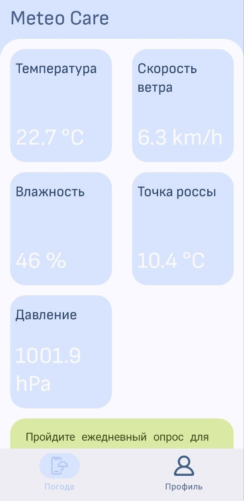
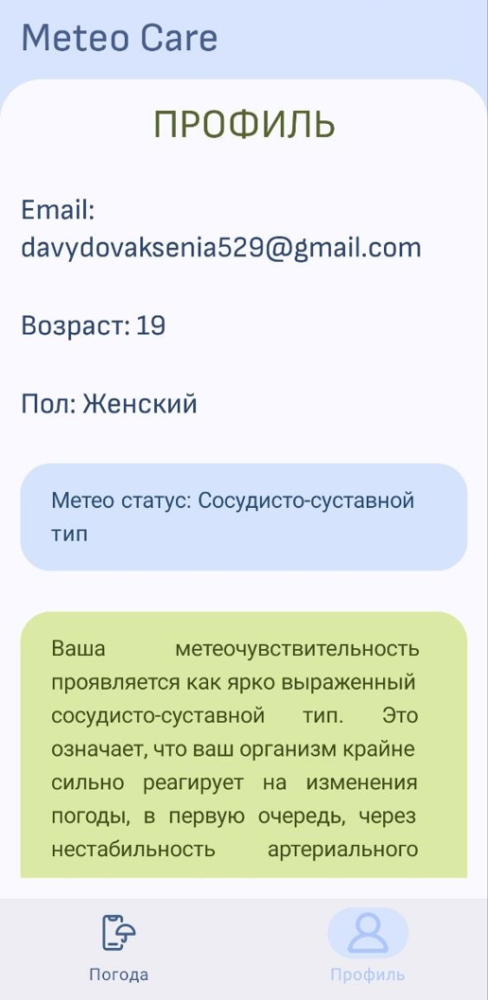

# ⛅ MeteoCare

Android-приложение для персонального мониторинга погодных условий и анализа их возможного влияния на самочувствие. Объединяет получение метеорологических данных, определение местоположения пользователя, хранение персонального профиля и AI-анализ погодных факторов. На основе этих данных приложение формирует индивидуальные рекомендации и ежедневные информационные сводки.

Проект построен на принципах Clean Architecture с использованием MVVM, Jetpack Compose и StateFlow.

## Скриншоты

<p align="center">
  
  
  
</p>

## Основные возможности

### Мониторинг погодных условий
получение актуальных метеорологических данных через Open-Meteo API, включая температуру, влажность, атмосферное давление, скорость ветра и осадки.
### Геолокация
определение текущего местоположения пользователя с помощью Google Play Services Location для получения прогноза погоды с учётом координат.
### Персональный профиль
регистрация и авторизация через Firebase Authentication, хранение пользовательских данных и настроек в Cloud Firestore.
### AI-анализ погоды
обработка метеорологических показателей с использованием Gemini API и формирование рекомендаций с учётом данных пользовательского профиля.
### Ежедневные сводки
генерация персонального статуса и рекомендаций на основе текущих погодных условий.
### Фоновые уведомления
автоматическое получение ежедневных уведомлений с использованием WorkManager и возможность управления настройками уведомлений.
### Визуализация данных
отображение погодных показателей с помощью графиков.

## Архитектура

В проекте используется **Clean Architecture** в сочетании с **MVVM**.

Приложение разделено на три основных слоя:

- **Data Layer** — получение погодных данных через Retrofit, работа с геолокацией, Firebase, Gemini API и системными уведомлениями.
- **Domain Layer** — модели предметной области, интерфейсы репозиториев и интеракторы, содержащие бизнес-логику.
- **Presentation Layer** — экраны Jetpack Compose, ViewModel и управление состояниями интерфейса через StateFlow.

Для внедрения зависимостей используется Koin, асинхронные операции выполняются с помощью Kotlin Coroutines и Flow.

Подробнее: [Архитектура приложения](docs/architecture.md).

## Технологии

| Категория | Инструменты |
|---|---|
| Язык и платформа | Kotlin, Android SDK |
| Минимальная версия Android | minSdk 24 |
| UI | Jetpack Compose, Material 3 |
| Навигация | Navigation Compose |
| Архитектура | Clean Architecture, MVVM |
| Управление состоянием | ViewModel, StateFlow |
| Асинхронность | Kotlin Coroutines, Flow |
| Сеть | Retrofit, Gson, OkHttp, REST API |
| Погодные данные | Open-Meteo API |
| AI | Gemini API |
| Авторизация и хранение данных | Firebase Authentication, Cloud Firestore |
| Геолокация | Google Play Services Location |
| Уведомления | WorkManager, NotificationCompat |
| Графики | Vico |
| Dependency Injection | Koin |

## Сборка и запуск

1. Клонируйте репозиторий:

   ```bash
   git clone https://github.com/bezFantazee/MeteoCare.git
   cd MeteoCare
   ```

2. Откройте проект в Android Studio и дождитесь завершения Gradle Sync.

3. Настройте Firebase: добавьте конфигурационный файл `google-services.json` в модуль приложения и настройте необходимые сервисы.

4. Настройте API-ключ Gemini. Не рекомендуется хранить секретные ключи непосредственно в исходном коде или публиковать их в репозитории.

5. Соберите Debug-версию:

   **Linux / macOS**
   ```bash
   ./gradlew assembleDebug
   ```

   **Windows**
   ```bat
   gradlew.bat assembleDebug
   ```

6. Для установки на подключённое устройство или запущенный эмулятор:

   **Linux / macOS**
   ```bash
   ./gradlew installDebug
   ```

   **Windows**
   ```bat
   gradlew.bat installDebug
   ```

## Планы развития

Текущие идеи по развитию приложения собраны в [Roadmap](docs/roadmap.md).
